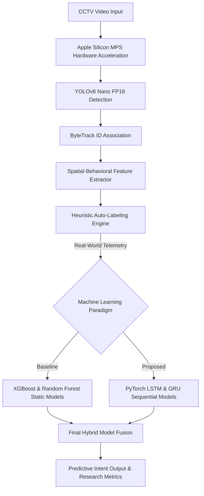

# 🛡️ Shift-Aware Spatial-Temporal Modeling for Intelligent Restricted Zone Monitoring


> **B.Tech Major Project Thesis Repository** <br>
> *Does explicit temporal memory improve pre-intrusion behavioral intent prediction compared with snapshot-based machine learning?*

## 🎬 Live Demonstrations & Test Cases
Recruiters and reviewers can view the final system in action below:
* **[🎥 Watch the Video Demo (Google Drive)](https://drive.google.com/drive/folders/1XPZcmRp3bV3tBFcflgMaWMtF3CzxYUcN?usp=sharing)** *(Insert Link Here)*
* **[📁 View Full Test Cases & Telemetry Outputs (Google Drive)](#)** *(Insert Link Here)*
* **[📄 Read the Final Research Paper (PDF)](#)** *(Insert Link Here)*

---

## 📖 Project Overview

Traditional intelligent video surveillance systems are **reactive**. They draw a polygon and trigger an alert only *after* a person steps inside a restricted zone. This is insufficient for high-security environments.

This research project introduces a **proactive** system capable of predicting a person's behavioral intent *before* they breach a perimeter. By analyzing spatial-behavioral features (speed variance, loitering duration, boundary proximity) over a continuous time window, the system determines whether a subject is performing a Casual Transit, Suspicious Loitering, Active Scouting, Fleeing, or a Critical Intrusion.

We successfully validated that recurrent neural networks (LSTMs with temporal memory) mathematically outperform advanced static classifiers (XGBoost) by +2.15% on a massive real-world dataset of **621,854 frames**.

---

## 🏗️ System Architecture Flow



---

## 🔬 Core Methodology

This repository is divided into four distinct computational layers:

### 1. The Computer Vision Extraction Pipeline
* **YOLOv8 & ByteTrack:** Extracts raw bounding box telemetry and tracks individuals continuously across frames.
* **Hardware Optimized:** Casts model precision to `FP16` and targets `Apple Silicon MPS`, doubling inference speed while maintaining a high `640x640` resolution to track distant subjects.

### 2. Spatial-Behavioral Feature Engineering
Raw pixels are converted into 7 highly-indicative intent vectors:
1. `speed_variance` (Pixels/sec)
2. `distance_to_restricted_zone` (Point-to-polygon distance)
3. `time_near_boundary` (High-risk buffer tracking)
4. `time_inside_zone` (Active breach tracking)
5. `sudden_stops` (Count of movement halts)
6. `carrying_baggage` (Binary physical threat indicator)
7. `time_of_day_multiplier` (Contextual risk scaling)

### 3. The Heuristic Auto-Labeler
To avoid the prohibitive cost of manually annotating 621,000 frames, a custom mathematical engine was built. It retroactively analyzes a subject's *complete trajectory* and assigns a ground-truth "True Intent" label (e.g., if a person stands perfectly still near a boundary for >10 seconds, they are mathematically labeled as `Active Scouting`).

### 4. Machine Learning & Deep Learning
* **Static Baselines:** Random Forest and XGBoost act as the benchmark. They look at a single frame (a snapshot) to guess intent.
* **Sequential LSTM/GRU:** The PyTorch models receive a rolling window tensor `(Batch, 15_Frames, 7_Features)`, granting them a 0.5-second contiguous memory of the subject's behavioral history.

---

## 📊 Real-World Results

The pipeline was executed on 3 hours of highly imbalanced, real-world CCTV footage containing over **621,800 frames**. **Track-Aware Splitting** was strictly enforced to prevent data leakage. Due to extreme natural class imbalances, models were evaluated exclusively on **Weighted F1 Score**.

| Model | Accuracy | Weighted F1 | Critical Recall | Inference Latency |
| :--- | :---: | :---: | :---: | :---: |
| **Random Forest** | 76.6% | 80.7% | 84.9% | 5.0 ms |
| **XGBoost** | 88.2% | 86.8% | 86.2% | 5.0 ms |
| **GRU** | 89.6% | 88.2% | 83.1% | 15.0 ms |
| **LSTM** | **90.4%** | **89.0%** | **86.4%** | 15.0 ms |

**Conclusion:** The PyTorch LSTM successfully improved behavioral intent prediction by **+2.15%** over the absolute best static model, proving that sequence memory is fundamental to understanding human intent. 

---

## 🚀 Quick Start / Reproducibility

### 1. Setup Environment
```bash
git clone https://github.com/AtharvaRathi/Major-Pro.git
cd Major-Pro
python -m venv .venv
source .venv/bin/activate
pip install -r requirements.txt
```

### 2. Run the Extraction Pipeline
Place your CCTV videos inside the `input/` directory, then run the YOLO tracker:
```bash
# Extract raw telemetry
python pipeline/extract_real_dataset.py --video input/train_video.mp4 --output research_framework/data/raw/train_raw.csv

# Auto-label the data mathematically
python pipeline/heuristic_labeler.py --input research_framework/data/raw/train_raw.csv --output research_framework/data/raw/real_train.csv
```

### 3. Run the Deep Learning Experiment
Train all static and sequential models, generate all 15 benchmark graphs (including PyTorch Permutation Feature Importance), and output the final CSV metrics:
```bash
PYTHONPATH=research_framework python research_framework/main_experiment.py --real-data
```

---

## 📁 Repository Structure

```text
Major-Pro/
├── pipeline/
│   ├── extract_real_dataset.py       # High-speed YOLOv8 + ByteTrack extraction
│   └── heuristic_labeler.py          # Ground-truth mathematical annotation engine
├── research_framework/
│   ├── main_experiment.py            # Master orchestration script
│   ├── src/
│   │   ├── dataset.py                # SequenceDataset and Track-Aware Splitting
│   │   ├── models_sequential.py      # PyTorch LSTMs & GRUs
│   │   ├── models_static.py          # XGBoost & Random Forest
│   │   ├── models_hybrid.py          # Fusion logic 
│   │   └── visualization.py          # 15+ automated matplotlib/seaborn graphs
│   ├── paper/                        
│   │   └── research_paper.html       # Final B.Tech Thesis Draft
│   └── results/
│       ├── figures/                  # Generated research charts and matrices
│       └── tables/                   # Final CSV benchmarks
├── core/
│   └── detector.py                   # FP16 Apple Silicon hardware acceleration wrapper
└── input/                            # (Ignored) Place raw .mp4 CCTV videos here
```
